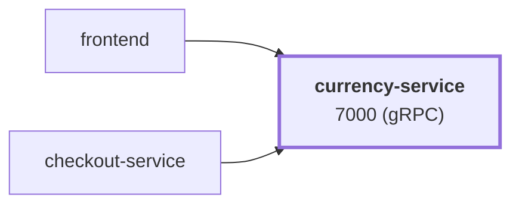

# currency-service

service · platform-demo

A gRPC service that converts monetary amounts between currencies for the platform-demo e-commerce platform. It reads a static table of exchange rates (relative to EUR) from a JSON file baked into the image and converts through EUR. It is stateless, has no downstream dependencies, and is called by `frontend` and `checkout-service`.

Runtime<strong>Node 22</strong><small>TypeScript</small>

Listens on<strong>7000</strong><small>gRPC</small>

State<strong>Stateless</strong>

Image<strong>currency-service</strong><small>mladenovskistefan/</small>

## Where it sits

Called by `frontend`, `checkout-service`. It has no downstream dependencies.

## At a glance

| | |
|---|---|
| **Language / runtime** | TypeScript on Node.js 22 (`@grpc/grpc-js`) |
| **Image** | `mladenovskistefan/currency-service` |
| **Protocol / port** | gRPC (HTTP/2, plaintext) on `7000` |
| **Metrics** | Pushed over OTLP/gRPC to Alloy → Mimir every 15 s (no scrape endpoint). Dashboard names: `rpc_server_duration_seconds_{bucket,count,sum}`, `rpc_server_requests_total`, `rpc_server_active_requests` |
| **Health** | `grpc.health.v1.Health/Check` on `7000` — static `SERVING` |
| **State** | None. Rates are read from `data/currency_conversion.json` (static, not live) |
| **Depends on** | Nothing (optional: OTLP collector, Pyroscope) |
| **Called by** | `frontend` (`GetSupportedCurrencies`, `Convert`), `checkout-service` (`Convert`) |
| **gRPC reflection** | Not enabled — pass `-proto` to `grpcurl` |

## Find it elsewhere

<h4><a href="https://argocd.platform-demo.test/applications/argocd/dev-currency-service">Argo CD</a></h4>
Sync and health of <code>dev-currency-service</code>.

<h4><a href="https://grafana.platform-demo.test/d/currency-service-overview">Grafana</a></h4>
Latency, traffic and errors (<code>currency-service-overview</code>).

<h4><a href="https://github.com/platform-boutique/app-currency-service">Repository</a></h4>
Source, pull requests and releases of <code>app-currency-service</code>.

!!! info "Part of the platform-demo platform"
    Cross-cutting facts (service wiring, observability contract, Kubernetes translation, CI/CD) are in the
    [master reference](https://github.com/platform-boutique/platform-demo-docs). This site only describes currency-service.
